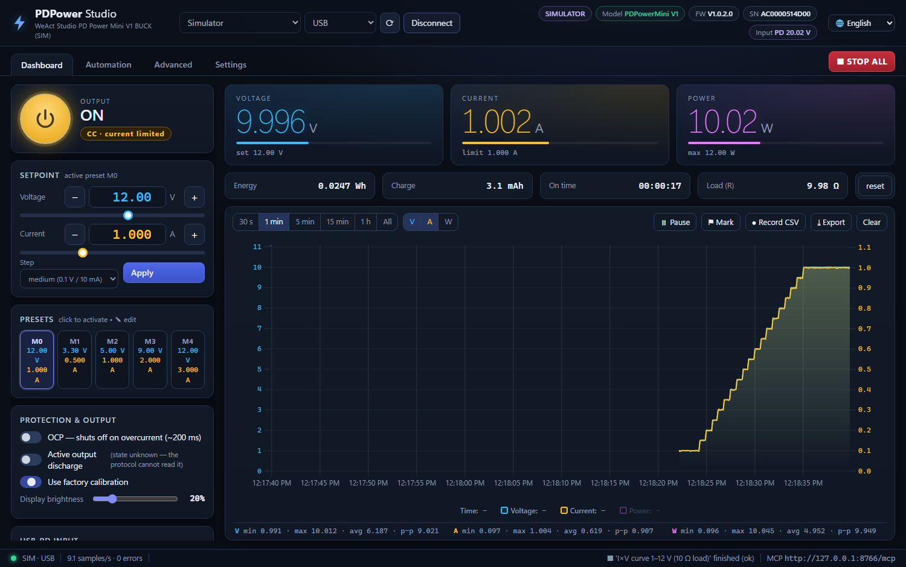
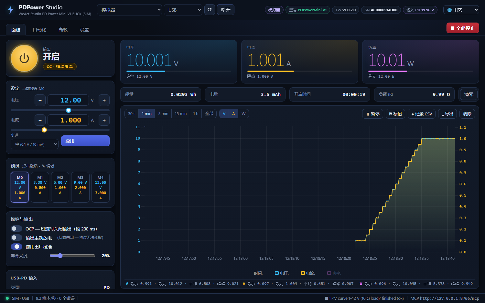
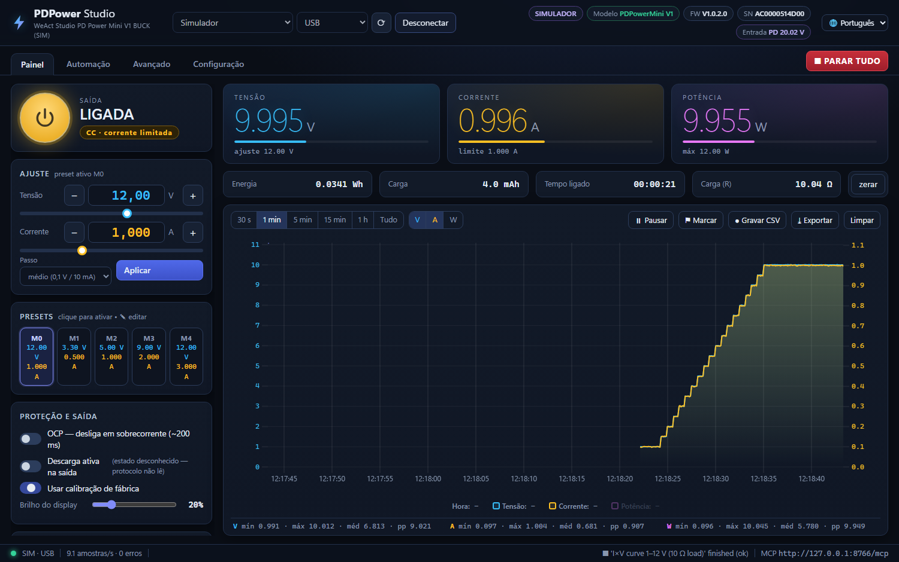
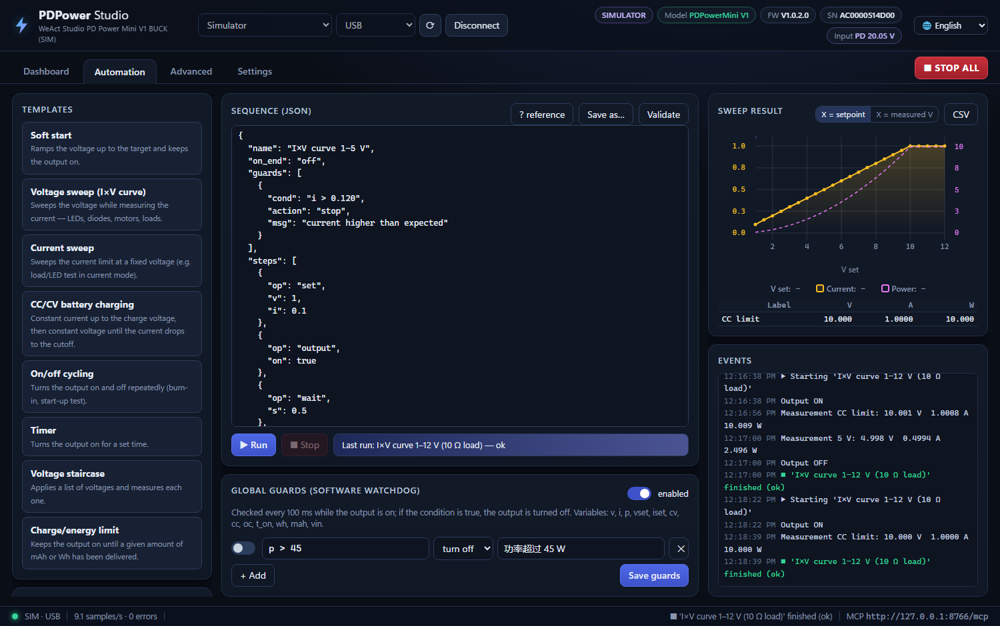

# PDPower Studio

**English** · [Português (Brasil)](README_pt-BR.md) · [简体中文](README_zh-CN.md)

Desktop control app for the **WeAct Studio PDPowerMini V1 / V1.1 (Buck)** USB‑PD bench power supply:
live charts, scripted automation and a built‑in **MCP server** so AI agents can operate the supply for you.



**[⬇ Download PDPower Studio.exe](https://github.com/EGaiotto/WeActStudio.PDPowerMiniV1-Buck/releases/tag/pdpower-studio-v1.0.0)**
· single file, Windows 10/11, no installation, no Python needed

> 🙏 Many thanks to the **[WeAct Studio](https://github.com/WeActStudio)** team for publishing the PDPowerMini
> communication protocol — this project would not exist without it. See [Acknowledgments](#acknowledgments).

---

## 🌐 Three languages

The whole program speaks **English**, **Português (Brasil)** and **简体中文 (Simplified Chinese)**:
interface, confirmations, error messages, the event log and even the sequences generated by the automation templates.

- Switch at any time from the **🌐 menu** in the top‑right corner; the choice is saved.
- On first start it follows the Windows display language (falls back to English).

| 简体中文 | Português (Brasil) |
|---|---|
|  |  |

## 🤖 MCP server — let an AI agent drive the supply

PDPower Studio exposes a [Model Context Protocol](https://modelcontextprotocol.io) server
(Streamable HTTP) at **`http://127.0.0.1:8765/mcp`** while the app is open. Any MCP client — Claude Code,
Claude Desktop, IDE agents — can read measurements, set voltage/current, toggle the output, run sweeps and
whole automation sequences.

```bash
claude mcp add --transport http --scope user pdpower http://127.0.0.1:8765/mcp
```

Other clients:

```json
{ "mcpServers": { "pdpower": { "type": "http", "url": "http://127.0.0.1:8765/mcp" } } }
```

Then just ask, e.g. *“sweep my LED from 2.5 V to 3.2 V with a 20 mA limit and tell me the forward voltage at 10 mA”*
or *“charge this 1S Li‑ion cell at 0.5 A and stop at 50 mA”*.

Built‑in safety: the agent works inside the **software limits** you set (it cannot change them), writing can be
switched to **read‑only** in Settings, factory reset requires an explicit confirmation, and firmware upgrade is
never exposed. The GUI, automations and MCP share one serial connection, so you watch everything the agent does
live on the chart.

<details>
<summary>The 21 MCP tools</summary>

| Tool | What it does |
|---|---|
| `pdpower_status` | full device state |
| `pdpower_measure`, `pdpower_history` | averaged measurement / history with statistics |
| `pdpower_set`, `pdpower_set_output` | V/I of the active preset, output on/off |
| `pdpower_set_preset`, `pdpower_select_preset` | presets M0–M4 |
| `pdpower_configure` | OCP, calibration, discharge, brightness, PD voltage |
| `pdpower_save_config`, `pdpower_system` | save to flash, reset, factory reset (confirmed) |
| `pdpower_run_sequence`, `pdpower_automation_status`, `pdpower_stop` | automation |
| `pdpower_sweep` | V or I sweep returning a results table |
| `pdpower_counters`, `pdpower_mark` | energy/charge counters, chart markers |
| `pdpower_calibration_data`, `pdpower_raw_read` | calibration table and raw protocol reads (read‑only) |
| `pdpower_connect`, `pdpower_disconnect`, `pdpower_list_ports` | connection |

</details>

## ⚙️ Automation



- **Ready‑made templates:** soft start · voltage sweep (I×V curve) · current sweep · CC/CV battery charging
  (Li‑ion, Li‑HV, LiFePO4, lead‑acid, custom; cells in series) · on/off cycling · timer · voltage staircase ·
  stop after N mAh / Wh.
- **JSON sequences** you can edit, validate, save and reuse: `set`, `output`, `wait`, `ramp`, `wait_until`,
  `measure`, `loop`, `preset`, `setting`, `log`, `mark`, `reset_counters`, `save_config`.
- **Conditions** such as `cc`, `i < 0.05`, `mah >= 500`, `p > 15 and t_on > 60`, evaluated by a restricted
  interpreter (no free `eval`).
- **Guards** — a 100 ms software watchdog that turns the output off when a condition becomes true, globally or
  per sequence.
- **Results:** XY chart of the sweep (vs. setpoint or measured V), measurement table, CSV export and an event log.
- **Esc = STOP ALL** (stops the sequence and turns the output off) from anywhere in the app.

```json
{
  "name": "LED curve", "on_end": "off",
  "guards": [{"cond": "i > 0.03", "action": "stop", "msg": "current too high"}],
  "steps": [
    {"op": "set", "v": 2.0, "i": 0.02}, {"op": "output", "on": true},
    {"op": "ramp", "param": "v", "from": 2.0, "to": 3.2, "step": 0.05, "dwell": 0.6},
    {"op": "wait_until", "cond": "cc", "timeout": 5, "on_timeout": "continue"},
    {"op": "measure", "s": 2, "label": "final"}
  ]
}
```

Condition variables: `v i p` (measured) · `vset iset` (setpoint) · `on cv cc oc` · `t` (s since start) ·
`t_on` (s with output on) · `wh mah` · `vin` — operators `and/or/not`, functions `abs min max round sqrt`.

---

## Everything else

**Dashboard** — big V/A/W readouts with setpoint bars, CV/CC/overcurrent badge, power button (**Space**),
fine/medium/coarse steps, 5 editable presets (M0–M4), OCP, active discharge, factory calibration on/off,
display brightness, USB‑PD voltage requested from the charger, save to flash, reset, factory defaults.
Energy (Wh), charge (mAh), on‑time and load resistance counters.

**Chart** — uPlot at ~10 samples/s, windows from 30 s to 1 h or everything (~7 h in memory), separate V/A/W axes,
drag to zoom (double‑click to go back), output‑off periods shaded, event markers, min/max/avg/p‑p statistics,
continuous CSV recording and export.

**Advanced** — factory calibration table (7 V + 7 I points): read, export/import JSON and verified write with an
automatic backup first; LCD panel type; raw protocol console; command reference.

**Settings** — software limits (max V/A for GUI, automation and MCP), polling interval, auto‑connect,
MCP write access, built‑in **simulator** (virtual board with a 10 Ω load) to try everything without hardware.

## Connecting the board

- **USB:** detected automatically (VID `1A86`, PID `FE0C`; serial starting with `AC` = V1, `B3` = V1.1).
- **UART:** pins DP→TX, DM→RX, 3.3 V, frames with CRC‑8 — enable *UART Mode* in the board menu and pick the baud rate.
- One instance owns the serial port; opening the app again only opens another window on the same server.

| Model | Output | PD request | Current |
|---|---|---|---|
| V1 (`AC…`) | 0.5–20 V | 8–24 V | 0.005–3 A |
| V1.1 (`B3…`) | 0.5–24 V | 8–28 V | 0.005–3 A |

The exe is not code‑signed, so Windows SmartScreen may warn on first launch (*More info → Run anyway*).

## Running from source

Requires Python 3.12 on Windows (WebView2 runtime, already present on Windows 11).

```bat
PDPower Studio.bat                 :: native window (creates .venv on first run)
PDPower Server (sem janela).bat    :: server + MCP only; open http://127.0.0.1:8765
```

Or: `.venv\Scripts\python -m pdpower.app [--headless | --browser] [--http-port 8765]`.
Tests: `.venv\Scripts\python -m pytest tests` (uses the simulator).
Build the single‑file exe: `build_exe\build.bat` → `dist\PDPower Studio.exe`.

Settings live in `%APPDATA%\PDPowerStudio\config.json` (log: `app.log`); CSV files and exports go to
`Documents\PDPowerStudio\`.

## Protocol (summary)

Read = command | `0x80`; writes get no response. USB frames end with `0x0A`; UART frames end with CRC‑8
(poly `0x31`, init `0xFF`). 16‑bit values are little‑endian (mV, mA; 0.1 V for PD). Full details in
[`pdpower/protocol.py`](pdpower/protocol.py) and in WeAct's spreadsheets in
[`Communication protocol/`](../../Communication%20protocol/). Command `0x41` (firmware upgrade) is intentionally
not exposed — use WeAct's official tool for that.

## Project layout

```
pdpower/protocol.py    frames, CRC-8, calibration table
pdpower/device.py      thread-safe driver, polling, auto-reconnect
pdpower/simulator.py   byte-level virtual board
pdpower/recorder.py    history, energy counters, CSV
pdpower/automation.py  sequences, sweeps, guards
pdpower/server.py      FastAPI (REST, WebSocket, static files) + MCP
pdpower/mcp_server.py  MCP tools
pdpower/i18n.py        backend translations (errors, events)
pdpower/web/           interface (HTML/CSS/JS + uPlot), i18n.js = UI translations
tests/                 pytest (simulator) and MCP smoke test
build_exe/             PyInstaller spec, icon, third-party notices generator
```

**Adding or fixing a translation:** the Portuguese text is the key in both dictionaries —
`pdpower/web/i18n.js` (interface) and `pdpower/i18n.py` (backend messages). New strings must be added to both.

## Safety

This software drives real hardware. Set the software limits for what is connected, keep guards on for unattended
runs (battery charging especially), and remember that the limits and guards are software checks — they do not
replace the board's own protections or a fuse.

## Acknowledgments

A big thank‑you to the **[WeAct Studio](https://github.com/WeActStudio)** team for openly publishing the
PDPowerMini **communication protocol** — the command tables and frame/CRC specification in
[`Communication protocol/`](../../Communication%20protocol/), together with the hardware documentation and the
source of their official tool. That openness is what made this project possible: every feature here, from the
live chart to the MCP server, is built on top of it.

Charts by [uPlot](https://github.com/leeoniya/uPlot) (Leon Sorokin).

## License

PDPower Studio is released under the [MIT License](LICENSE). Bundled third‑party components keep their own
licenses — see [THIRD_PARTY_NOTICES.md](THIRD_PARTY_NOTICES.md) and
[`pdpower/web/vendor/uPlot.LICENSE`](pdpower/web/vendor/uPlot.LICENSE).
The PDPowerMini hardware, firmware, protocol documents and official tools elsewhere in this repository belong to
[WeAct Studio](https://github.com/WeActStudio/WeActStudio.PDPowerMiniV1-Buck); this is an independent,
unofficial project.
