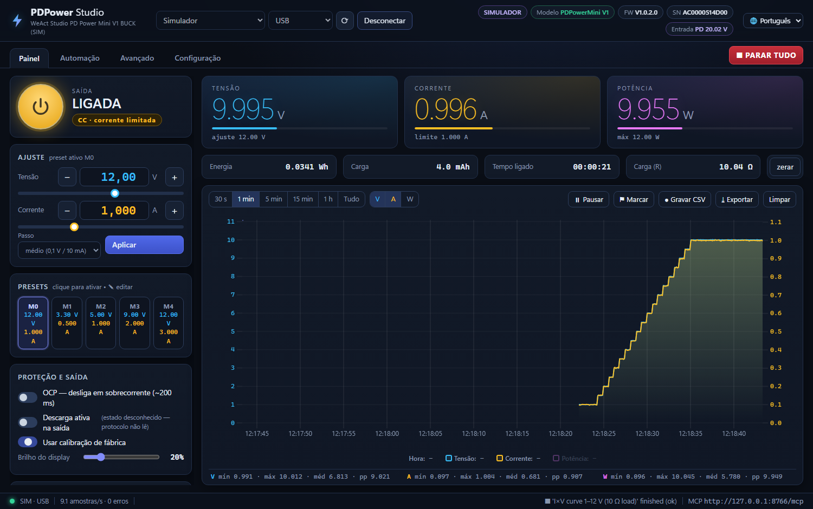
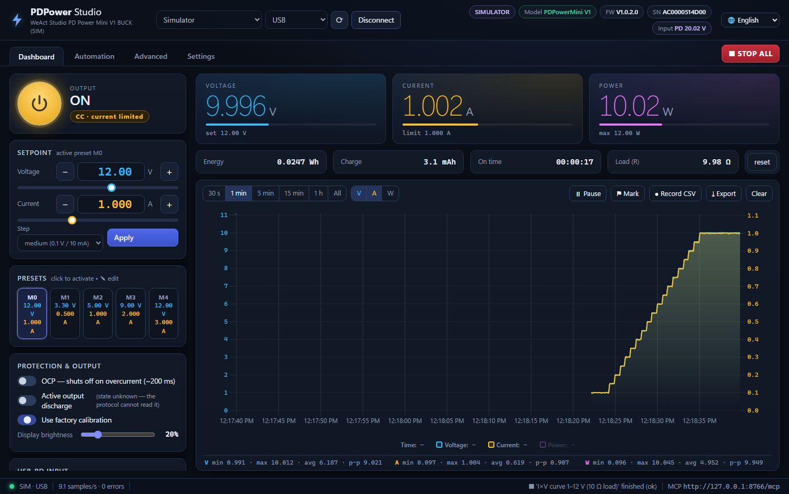
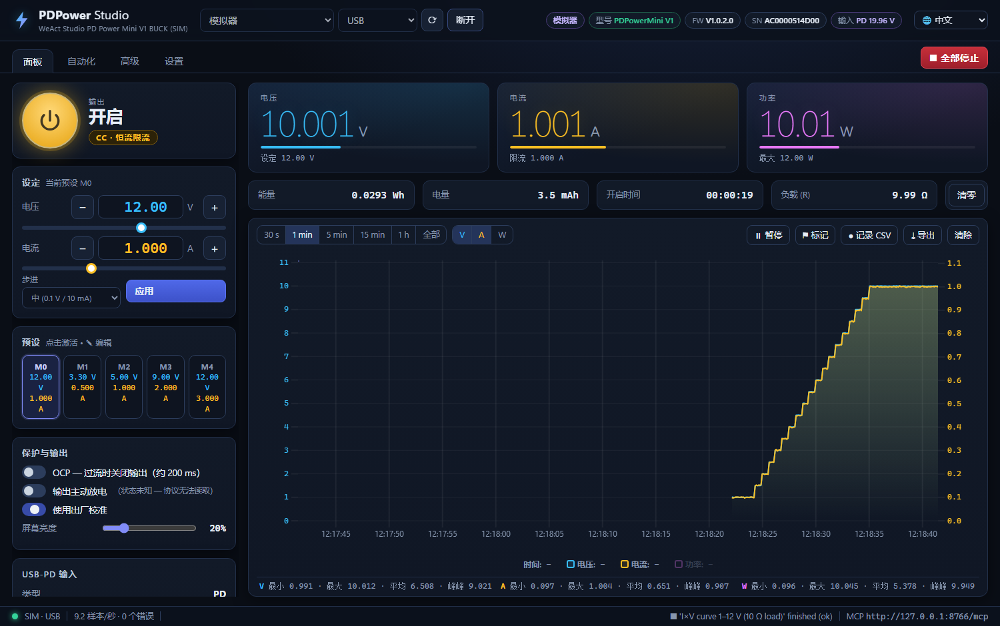
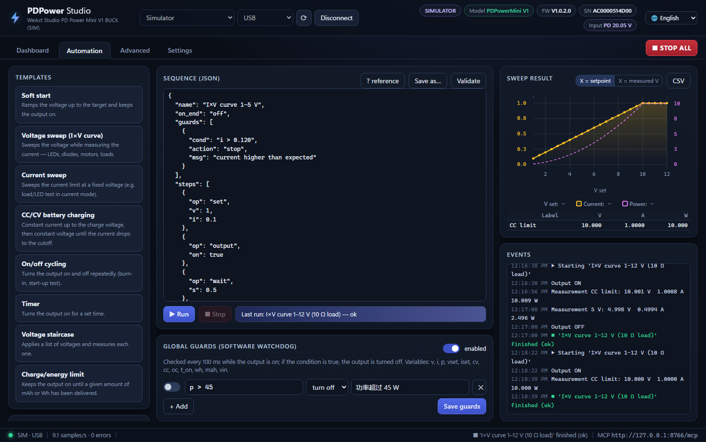

# PDPower Studio

[English](README.md) · **Português (Brasil)** · [简体中文](README_zh-CN.md)

Programa de controle para a fonte de bancada USB‑PD **WeAct Studio PDPowerMini V1 / V1.1 (Buck)**:
gráficos ao vivo, automação por sequências e um **servidor MCP** embutido para que agentes de IA operem a fonte por você.



**[⬇ Baixar PDPower Studio.exe](https://github.com/EGaiotto/WeActStudio.PDPowerMiniV1-Buck/releases/tag/pdpower-studio-v1.0.0)**
· arquivo único, Windows 10/11, sem instalação, não precisa de Python

> 🙏 Muito obrigado à equipe da **[WeAct Studio](https://github.com/WeActStudio)** por publicar o protocolo de
> comunicação da PDPowerMini — sem ele este projeto não existiria. Veja [Agradecimentos](#agradecimentos).

---

## 🌐 Três idiomas

O programa inteiro funciona em **português (Brasil)**, **inglês** e **chinês simplificado (简体中文)**:
interface, confirmações, mensagens de erro, registro de eventos e até as sequências geradas pelos modelos de automação.

- Troque quando quiser pelo **menu 🌐** no canto superior direito; a escolha fica salva.
- Na primeira execução segue o idioma do Windows (inglês se não for português nem chinês).

| English | 简体中文 |
|---|---|
|  |  |

## 🤖 Servidor MCP — um agente de IA controlando a fonte

Com o programa aberto, o PDPower Studio oferece um servidor [Model Context Protocol](https://modelcontextprotocol.io)
(Streamable HTTP) em **`http://127.0.0.1:8765/mcp`**. Qualquer cliente MCP — Claude Code, Claude Desktop, agentes
de IDE — pode ler medidas, ajustar tensão/corrente, ligar e desligar a saída, fazer varreduras e rodar sequências inteiras.

```bash
claude mcp add --transport http --scope user pdpower http://127.0.0.1:8765/mcp
```

Outros clientes:

```json
{ "mcpServers": { "pdpower": { "type": "http", "url": "http://127.0.0.1:8765/mcp" } } }
```

Depois é só pedir, por exemplo: *“varra meu LED de 2,5 V a 3,2 V com limite de 20 mA e me diga a tensão direta a 10 mA”*
ou *“carregue esta célula Li‑ion 1S a 0,5 A e pare em 50 mA”*.

Segurança embutida: o agente trabalha dentro dos **limites de software** que você definiu (e não consegue alterá‑los),
a escrita pode ser colocada em **somente leitura** na Configuração, a restauração de fábrica exige confirmação
explícita e a atualização de firmware nunca é exposta. Interface, automação e MCP compartilham a mesma conexão serial,
então você acompanha tudo o que o agente faz ao vivo no gráfico.

<details>
<summary>As 21 ferramentas MCP</summary>

| Ferramenta | Função |
|---|---|
| `pdpower_status` | estado completo |
| `pdpower_measure`, `pdpower_history` | medição média / histórico com estatísticas |
| `pdpower_set`, `pdpower_set_output` | V/I do preset ativo, liga/desliga |
| `pdpower_set_preset`, `pdpower_select_preset` | presets M0–M4 |
| `pdpower_configure` | OCP, calibração, descarga, brilho, tensão PD |
| `pdpower_save_config`, `pdpower_system` | flash, reset, fábrica (com confirmação) |
| `pdpower_run_sequence`, `pdpower_automation_status`, `pdpower_stop` | automação |
| `pdpower_sweep` | varredura de V ou I com tabela de resultados |
| `pdpower_counters`, `pdpower_mark` | contadores de energia/carga, marcadores no gráfico |
| `pdpower_calibration_data`, `pdpower_raw_read` | tabela de calibração e comandos crus (só leitura) |
| `pdpower_connect`, `pdpower_disconnect`, `pdpower_list_ports` | conexão |

</details>

## ⚙️ Automação



- **Modelos prontos:** partida suave · varredura de tensão (curva I×V) · varredura de corrente · carga de bateria CC/CV
  (Li‑ion, Li‑HV, LiFePO4, chumbo‑ácido, personalizado; células em série) · ciclagem liga/desliga · temporizador ·
  escada de tensões · parar após N mAh / Wh.
- **Sequências JSON** editáveis, com validação, salvas para reutilizar: `set`, `output`, `wait`, `ramp`, `wait_until`,
  `measure`, `loop`, `preset`, `setting`, `log`, `mark`, `reset_counters`, `save_config`.
- **Condições** como `cc`, `i < 0.05`, `mah >= 500`, `p > 15 and t_on > 60`, avaliadas por um interpretador restrito
  (sem `eval` livre).
- **Guardas** — watchdog de software a cada 100 ms que desliga a saída quando uma condição fica verdadeira, global ou por sequência.
- **Resultados:** gráfico XY da varredura (contra o ajuste ou a V medida), tabela de medidas, exportação CSV e registro de eventos.
- **Esc = PARAR TUDO** (para a sequência e desliga a saída) de qualquer lugar do programa.

```json
{
  "name": "Curva do LED", "on_end": "off",
  "guards": [{"cond": "i > 0.03", "action": "stop", "msg": "corrente alta"}],
  "steps": [
    {"op": "set", "v": 2.0, "i": 0.02}, {"op": "output", "on": true},
    {"op": "ramp", "param": "v", "from": 2.0, "to": 3.2, "step": 0.05, "dwell": 0.6},
    {"op": "wait_until", "cond": "cc", "timeout": 5, "on_timeout": "continue"},
    {"op": "measure", "s": 2, "label": "final"}
  ]
}
```

Variáveis das condições: `v i p` (medidas) · `vset iset` (ajuste) · `on cv cc oc` · `t` (s desde o início) ·
`t_on` (s com a saída ligada) · `wh mah` · `vin` — operadores `and/or/not`, funções `abs min max round sqrt`.

---

## Demais recursos

**Painel** — leituras grandes de V/A/W com barra em relação ao ajuste, indicação CV/CC/sobrecorrente, botão de saída
(**Espaço**), passo fino/médio/grosso, 5 presets editáveis (M0–M4), OCP, descarga ativa, calibração de fábrica,
brilho do display, tensão pedida ao carregador USB‑PD, salvar na flash, reiniciar, padrão de fábrica.
Contadores de energia (Wh), carga (mAh), tempo ligado e resistência da carga.

**Gráfico** — uPlot a ~10 amostras/s, janelas de 30 s a 1 h ou tudo (~7 h em memória), eixos próprios para V/A/W,
zoom por arraste (duplo clique volta), períodos com saída desligada sombreados, marcadores, estatísticas
mín/máx/média/pico‑a‑pico, gravação contínua em CSV e exportação.

**Avançado** — tabela de calibração de fábrica (7 pontos V + 7 pontos I): leitura, exportação/importação JSON e
gravação verificada com backup automático antes; tipo de painel LCD; console cru do protocolo; referência dos comandos.

**Configuração** — limites de software (V/A máx. para interface, automação e MCP), intervalo de leitura, autoconexão,
permissão de escrita do MCP e **simulador** embutido (placa virtual com carga de 10 Ω) para testar tudo sem hardware.

## Conectando a placa

- **USB:** detecção automática (VID `1A86`, PID `FE0C`; número de série começando com `AC` = V1, `B3` = V1.1).
- **UART:** pinos DP→TX, DM→RX, 3,3 V, quadros com CRC‑8 — habilite *UART Mode* no menu da placa e escolha o baud.
- Uma única instância é dona da porta serial; abrir o programa de novo só abre outra janela para o mesmo servidor.

| Modelo | Saída | Pedido PD | Corrente |
|---|---|---|---|
| V1 (`AC…`) | 0,5–20 V | 8–24 V | 0,005–3 A |
| V1.1 (`B3…`) | 0,5–24 V | 8–28 V | 0,005–3 A |

O .exe não é assinado digitalmente, então o SmartScreen do Windows pode avisar na primeira vez
(*Mais informações → Executar assim mesmo*).

## Rodando pelo código‑fonte

Requer Python 3.12 no Windows (runtime WebView2, já presente no Windows 11).

```bat
PDPower Studio.bat                 :: janela nativa (cria o .venv na 1ª vez)
PDPower Server (sem janela).bat    :: só servidor + MCP; abra http://127.0.0.1:8765
```

Ou: `.venv\Scripts\python -m pdpower.app [--headless | --browser] [--http-port 8765]`.
Testes: `.venv\Scripts\python -m pytest tests` (usam o simulador).
Gerar o .exe de arquivo único: `build_exe\build.bat` → `dist\PDPower Studio.exe`.

Configuração em `%APPDATA%\PDPowerStudio\config.json` (log: `app.log`); CSV e exportações em `Documentos\PDPowerStudio\`.

## Protocolo (resumo)

Leitura = comando | `0x80`; escrita não tem resposta. USB: quadro termina em `0x0A`; UART: termina em CRC‑8
(poli `0x31`, init `0xFF`). Valores de 16 bits little‑endian (mV, mA; 0,1 V para PD). Detalhes em
[`pdpower/protocol.py`](pdpower/protocol.py) e nas planilhas da WeAct em
[`Communication protocol/`](../../Communication%20protocol/). O comando `0x41` (atualização de firmware) não é
exposto de propósito — use a ferramenta oficial da WeAct.

## Estrutura

```
pdpower/protocol.py    quadros, CRC-8, tabela de calibração
pdpower/device.py      driver thread-safe, polling, reconexão automática
pdpower/simulator.py   placa virtual no nível de bytes
pdpower/recorder.py    histórico, contadores de energia, CSV
pdpower/automation.py  sequências, varreduras, guardas
pdpower/server.py      FastAPI (REST, WebSocket, arquivos estáticos) + MCP
pdpower/mcp_server.py  ferramentas MCP
pdpower/i18n.py        traduções do backend (erros, eventos)
pdpower/web/           interface (HTML/CSS/JS + uPlot), i18n.js = traduções da interface
tests/                 pytest (simulador) e teste de fumaça do MCP
build_exe/             spec do PyInstaller, ícone, gerador dos avisos de terceiros
```

**Para adicionar ou corrigir uma tradução:** o texto em português é a chave nos dois dicionários —
`pdpower/web/i18n.js` (interface) e `pdpower/i18n.py` (mensagens do backend). Texto novo precisa entrar nos dois.

## Segurança

Este programa controla hardware real. Ajuste os limites de software para o que estiver conectado, mantenha guardas
ativas em execuções sem supervisão (principalmente carga de baterias) e lembre que limites e guardas são verificações
de software — não substituem as proteções da placa nem um fusível.

## Agradecimentos

Um grande obrigado à equipe da **[WeAct Studio](https://github.com/WeActStudio)** por publicar abertamente o
**protocolo de comunicação** da PDPowerMini — as tabelas de comandos e a especificação de quadros/CRC em
[`Communication protocol/`](../../Communication%20protocol/), junto com a documentação do hardware e o código‑fonte
da ferramenta oficial. Essa abertura é o que viabilizou este projeto: todos os recursos, do gráfico ao vivo ao
servidor MCP, foram construídos sobre ela.

Gráficos com [uPlot](https://github.com/leeoniya/uPlot) (Leon Sorokin).

## Licença

O PDPower Studio é distribuído sob a [licença MIT](LICENSE). Os componentes de terceiros incluídos mantêm suas
próprias licenças — veja [THIRD_PARTY_NOTICES.md](THIRD_PARTY_NOTICES.md) e
[`pdpower/web/vendor/uPlot.LICENSE`](pdpower/web/vendor/uPlot.LICENSE).
O hardware, o firmware, os documentos de protocolo e as ferramentas oficiais no restante deste repositório pertencem
à [WeAct Studio](https://github.com/WeActStudio/WeActStudio.PDPowerMiniV1-Buck); este é um projeto independente e não oficial.
