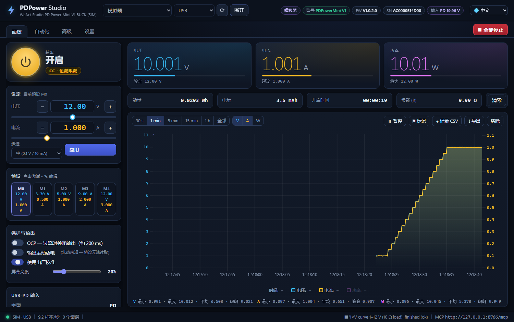
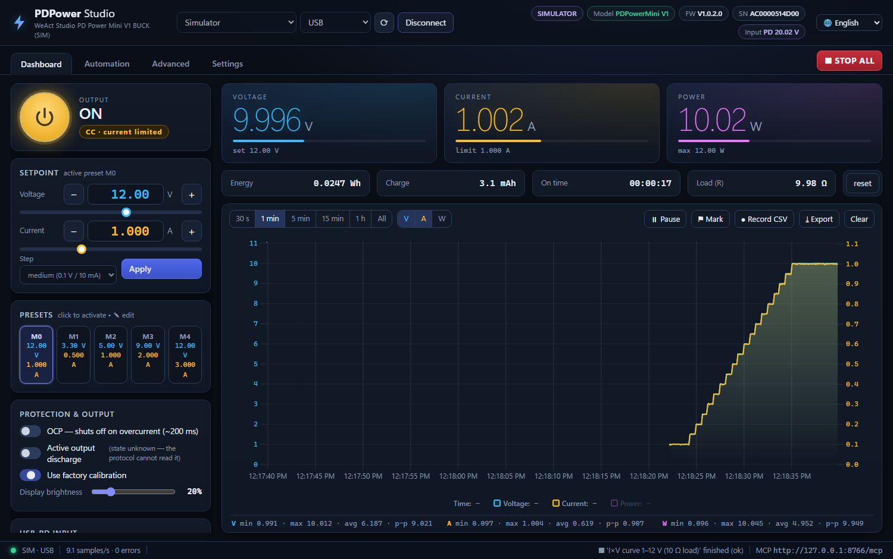
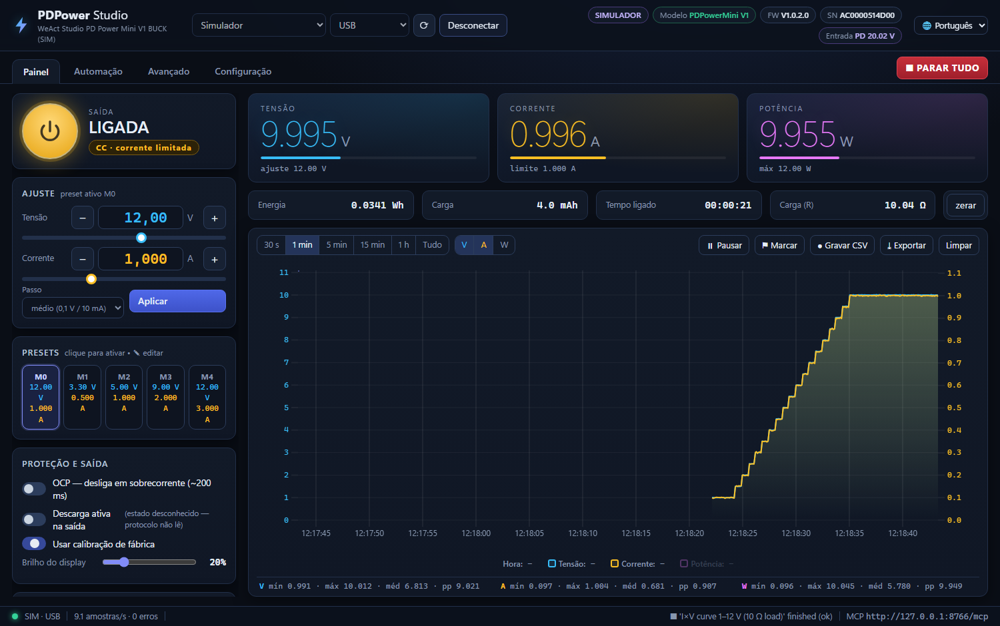
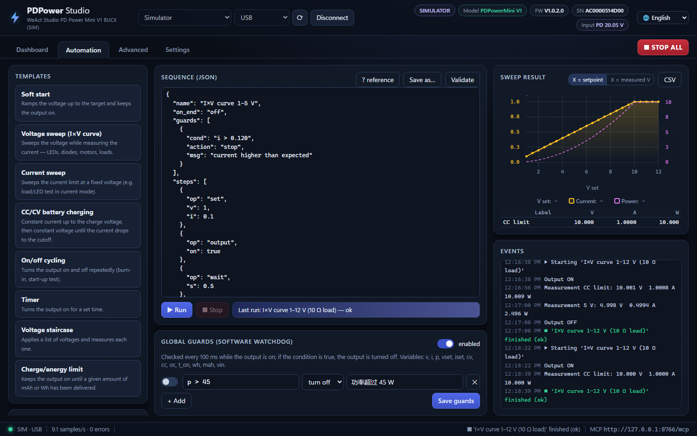

# PDPower Studio

[English](README.md) · [Português (Brasil)](README_pt-BR.md) · **简体中文**

**WeAct Studio PDPowerMini V1 / V1.1（Buck）** USB‑PD 桌面电源的上位机控制程序：
实时曲线、脚本化自动化，并内置 **MCP 服务器**，让 AI 智能体替你操作电源。



**[⬇ 下载 PDPower Studio.exe](https://github.com/EGaiotto/WeActStudio.PDPowerMiniV1-Buck/releases/tag/pdpower-studio-v1.0.0)**
· 单文件，Windows 10/11，免安装，无需 Python

> 🙏 衷心感谢 **[WeAct Studio](https://github.com/WeActStudio)** 团队公开 PDPowerMini 的通信协议——没有它就没有这个项目。
> 详见[致谢](#致谢)。

---

## 🌐 三种语言

整个程序支持 **简体中文**、**English** 和 **Português (Brasil)**：
界面、确认对话框、错误信息、事件日志，甚至自动化模板生成的序列都会使用所选语言。

- 随时通过右上角的 **🌐 菜单** 切换，选择会被保存。
- 首次启动时跟随 Windows 显示语言（非中文/葡萄牙语时使用英文）。

| English | Português (Brasil) |
|---|---|
|  |  |

## 🤖 MCP 服务器——让 AI 智能体控制电源

程序运行时，PDPower Studio 会在 **`http://127.0.0.1:8765/mcp`** 提供
[Model Context Protocol](https://modelcontextprotocol.io) 服务器（Streamable HTTP）。任何 MCP 客户端——Claude Code、
Claude Desktop、IDE 智能体——都可以读取测量值、设置电压/电流、开关输出、执行扫描和完整的自动化序列。

```bash
claude mcp add --transport http --scope user pdpower http://127.0.0.1:8765/mcp
```

其他客户端：

```json
{ "mcpServers": { "pdpower": { "type": "http", "url": "http://127.0.0.1:8765/mcp" } } }
```

然后直接提出需求，例如：*“把我的 LED 从 2.5 V 扫描到 3.2 V，限流 20 mA，告诉我 10 mA 时的正向电压”*，
或 *“以 0.5 A 给这节 1S 锂电池充电，电流降到 50 mA 时停止”*。

内置安全机制：智能体只能在你设定的 **软件限制** 内工作（无法修改限制）；可在设置中把 MCP 改为 **只读**；
恢复出厂需要明确确认；固件升级从不开放。界面、自动化和 MCP 共用同一串口连接，智能体的每个操作都能在曲线上实时看到。

<details>
<summary>21 个 MCP 工具</summary>

| 工具 | 功能 |
|---|---|
| `pdpower_status` | 完整设备状态 |
| `pdpower_measure`, `pdpower_history` | 平均测量值 / 带统计的历史数据 |
| `pdpower_set`, `pdpower_set_output` | 当前预设的电压/电流，开关输出 |
| `pdpower_set_preset`, `pdpower_select_preset` | 预设 M0–M4 |
| `pdpower_configure` | OCP、校准、放电、亮度、PD 电压 |
| `pdpower_save_config`, `pdpower_system` | 保存到闪存、复位、恢复出厂（需确认） |
| `pdpower_run_sequence`, `pdpower_automation_status`, `pdpower_stop` | 自动化 |
| `pdpower_sweep` | 电压或电流扫描并返回结果表 |
| `pdpower_counters`, `pdpower_mark` | 能量/电量计数器，曲线标记 |
| `pdpower_calibration_data`, `pdpower_raw_read` | 校准表与原始协议读取（只读） |
| `pdpower_connect`, `pdpower_disconnect`, `pdpower_list_ports` | 连接 |

</details>

## ⚙️ 自动化



- **现成模板：** 软启动 · 电压扫描（I×V 曲线）· 电流扫描 · CC/CV 电池充电（锂离子、高压锂电、磷酸铁锂、铅酸、
  自定义；支持串联节数）· 开关循环 · 定时器 · 电压阶梯 · 输出 N mAh / Wh 后停止。
- **JSON 序列**：可编辑、校验、保存并复用——`set`、`output`、`wait`、`ramp`、`wait_until`、`measure`、`loop`、
  `preset`、`setting`、`log`、`mark`、`reset_counters`、`save_config`。
- **条件表达式**：如 `cc`、`i < 0.05`、`mah >= 500`、`p > 15 and t_on > 60`，由受限解释器求值（不使用任意 `eval`）。
- **保护（Guards）**：每 100 ms 运行的软件看门狗，条件为真时关闭输出，可全局或按序列设置。
- **结果**：扫描 XY 曲线（相对设定值或实测电压）、测量表、CSV 导出和事件日志。
- **Esc = 全部停止**（停止序列并关闭输出），在程序任意位置可用。

```json
{
  "name": "LED 曲线", "on_end": "off",
  "guards": [{"cond": "i > 0.03", "action": "stop", "msg": "电流过高"}],
  "steps": [
    {"op": "set", "v": 2.0, "i": 0.02}, {"op": "output", "on": true},
    {"op": "ramp", "param": "v", "from": 2.0, "to": 3.2, "step": 0.05, "dwell": 0.6},
    {"op": "wait_until", "cond": "cc", "timeout": 5, "on_timeout": "continue"},
    {"op": "measure", "s": 2, "label": "final"}
  ]
}
```

条件变量：`v i p`（实测）· `vset iset`（设定）· `on cv cc oc` · `t`（开始后秒数）· `t_on`（输出开启秒数）·
`wh mah` · `vin`——运算符 `and/or/not`，函数 `abs min max round sqrt`。

---

## 其他功能

**面板**——大字号电压/电流/功率读数及相对设定值的进度条，CV/CC/过流状态，输出按钮（**空格键**），细/中/粗步进，
5 个可编辑预设（M0–M4），OCP，主动放电，出厂校准开关，屏幕亮度，向 USB‑PD 充电器请求的电压，保存到闪存、重启、
恢复出厂。能量（Wh）、电量（mAh）、开启时间和负载电阻计数。

**曲线**——uPlot，约 10 样本/秒，时间窗口 30 s 至 1 h 或全部（内存约 7 h），电压/电流/功率独立坐标轴，拖动缩放
（双击还原），输出关闭时段阴影显示，事件标记，最小/最大/平均/峰峰值统计，连续 CSV 记录与导出。

**高级**——出厂校准表（7 个电压点 + 7 个电流点）：读取、JSON 导出/导入，写入前自动备份并在写入后校验；LCD 面板类型；
原始协议控制台；命令参考。

**设置**——软件限制（界面、自动化和 MCP 共用的最大电压/电流）、读取间隔、自动连接、MCP 写入权限，以及内置
**模拟器**（带 10 Ω 负载的虚拟设备），无需硬件即可体验全部功能。

## 连接设备

- **USB：** 自动识别（VID `1A86`，PID `FE0C`；序列号以 `AC` 开头为 V1，`B3` 开头为 V1.1）。
- **UART：** DP→TX、DM→RX，3.3 V，帧带 CRC‑8——在设备菜单中开启 *UART Mode* 并选择波特率。
- 同一时间只有一个实例占用串口；再次打开程序只会为同一服务器再开一个窗口。

| 型号 | 输出 | PD 请求 | 电流 |
|---|---|---|---|
| V1（`AC…`） | 0.5–20 V | 8–24 V | 0.005–3 A |
| V1.1（`B3…`） | 0.5–24 V | 8–28 V | 0.005–3 A |

该 exe 未进行代码签名，首次运行时 Windows SmartScreen 可能提示（*更多信息 → 仍要运行*）。

## 从源码运行

需要 Windows 上的 Python 3.12（WebView2 运行时，Windows 11 已自带）。

```bat
PDPower Studio.bat                 :: 原生窗口（首次运行时创建 .venv）
PDPower Server (sem janela).bat    :: 仅服务器 + MCP；打开 http://127.0.0.1:8765
```

或：`.venv\Scripts\python -m pdpower.app [--headless | --browser] [--http-port 8765]`。
测试：`.venv\Scripts\python -m pytest tests`（使用模拟器）。
生成单文件 exe：`build_exe\build.bat` → `dist\PDPower Studio.exe`。

配置保存在 `%APPDATA%\PDPowerStudio\config.json`（日志：`app.log`）；CSV 和导出文件保存在 `文档\PDPowerStudio\`。

## 协议（摘要）

读取 = 命令 | `0x80`；写入无响应。USB 帧以 `0x0A` 结尾；UART 帧以 CRC‑8 结尾（多项式 `0x31`，初值 `0xFF`）。
16 位数值为小端序（mV、mA；PD 为 0.1 V）。详见 [`pdpower/protocol.py`](pdpower/protocol.py) 以及 WeAct 在
[`Communication protocol/`](../../Communication%20protocol/) 中的表格。命令 `0x41`（固件升级）有意不开放——请使用
WeAct 官方工具。

## 项目结构

```
pdpower/protocol.py    帧、CRC-8、校准表
pdpower/device.py      线程安全驱动、轮询、自动重连
pdpower/simulator.py   字节级虚拟设备
pdpower/recorder.py    历史数据、能量计数、CSV
pdpower/automation.py  序列、扫描、保护
pdpower/server.py      FastAPI（REST、WebSocket、静态文件）+ MCP
pdpower/mcp_server.py  MCP 工具
pdpower/i18n.py        后端翻译（错误、事件）
pdpower/web/           界面（HTML/CSS/JS + uPlot），i18n.js = 界面翻译
tests/                 pytest（模拟器）与 MCP 冒烟测试
build_exe/             PyInstaller 配置、图标、第三方声明生成脚本
```

**添加或修正翻译：** 两个词典都以葡萄牙语文本为键——`pdpower/web/i18n.js`（界面）和 `pdpower/i18n.py`（后端消息）。
新增文本需要同时加入两处。

## 安全提示

本软件控制真实硬件。请根据所连接的负载设置软件限制，无人值守运行（尤其是电池充电）时保持保护开启，并注意限制和保护
都是软件检查——不能替代设备自身的保护或保险丝。

## 致谢

衷心感谢 **[WeAct Studio](https://github.com/WeActStudio)** 团队公开发布 PDPowerMini 的 **通信协议**——
[`Communication protocol/`](../../Communication%20protocol/) 中的命令表和帧/CRC 规范，以及硬件资料和官方工具的源代码。
正是这份开放让本项目成为可能：从实时曲线到 MCP 服务器，所有功能都建立在它之上。

曲线由 [uPlot](https://github.com/leeoniya/uPlot)（Leon Sorokin）绘制。

## 许可证

PDPower Studio 以 [MIT 许可证](LICENSE) 发布。随附的第三方组件保留各自的许可证——见
[THIRD_PARTY_NOTICES.md](THIRD_PARTY_NOTICES.md) 和 [`pdpower/web/vendor/uPlot.LICENSE`](pdpower/web/vendor/uPlot.LICENSE)。
本仓库其余部分的 PDPowerMini 硬件、固件、协议文档和官方工具归
[WeAct Studio](https://github.com/WeActStudio/WeActStudio.PDPowerMiniV1-Buck) 所有；本项目为独立的非官方项目。
